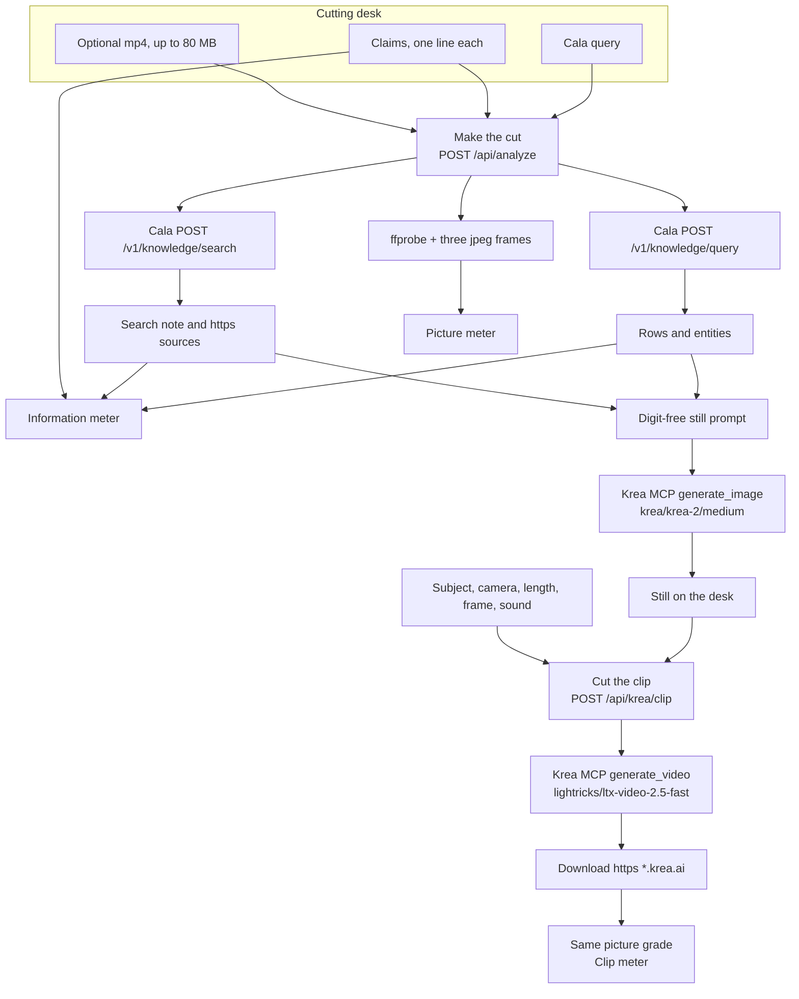
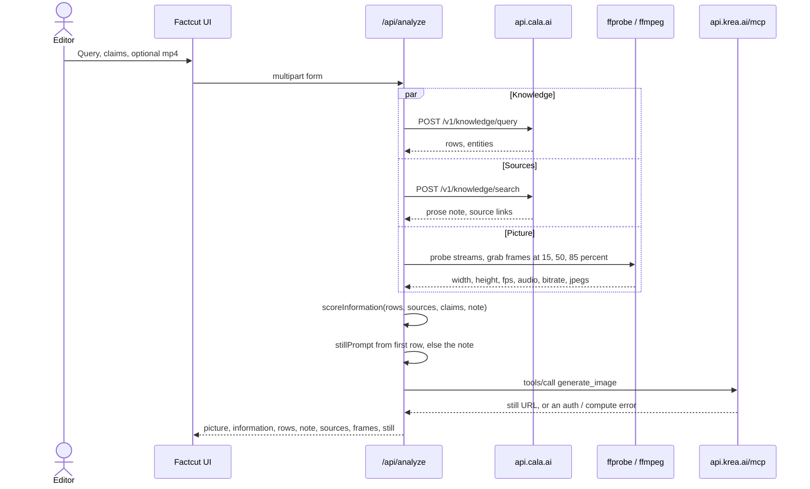
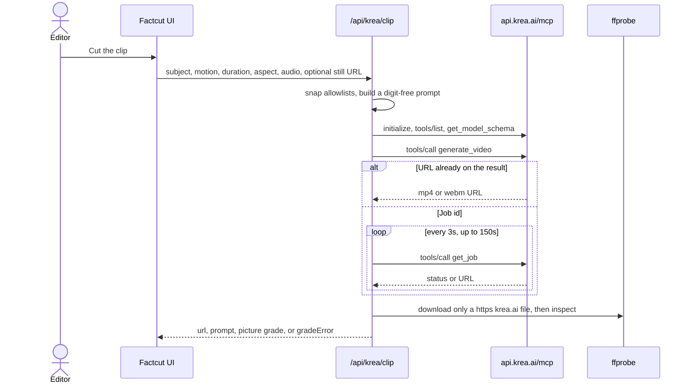
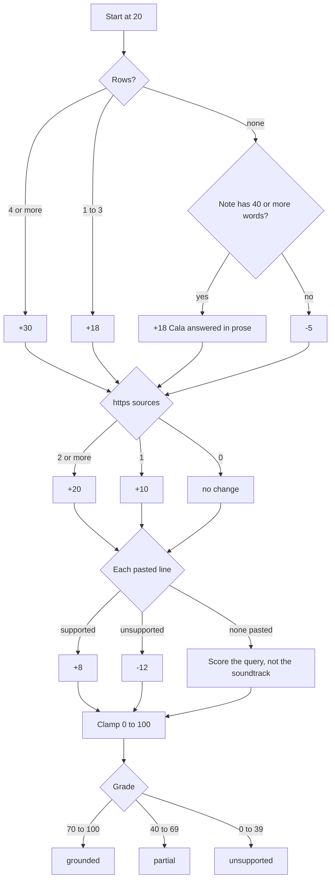
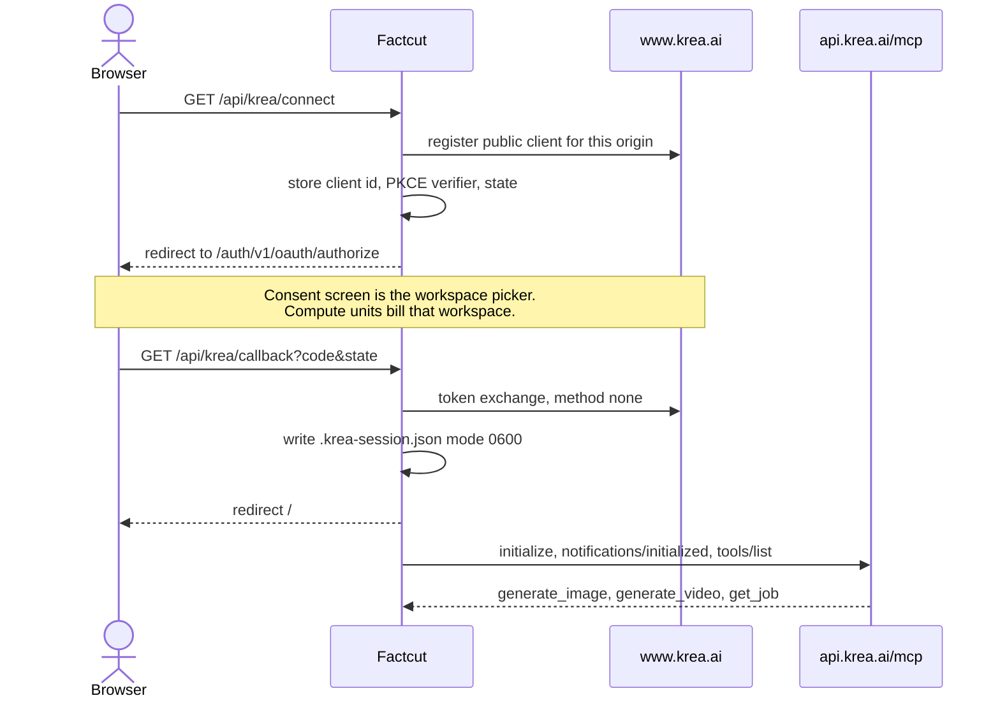

# Factcut

Factcut takes one [Cala](https://cala.ai) knowledge query and, if you drop a file, one video. It reports two scores: **picture** (the file) and **information** (the query). After you sign in to [Krea](https://www.krea.ai), the same cut can paint a still and, on a second button, generate a short clip and grade that file too.

This is the step before a publishability check. [Aubric](https://aubric.ai) asks whether an ad is allowed to ship. Factcut asks whether the file is fit to run and whether the claim is in the query result at all.

Factcut does not give legal, medical, or advertising clearance. A human makes the ship call. The app does not listen to the video. Paste the lines the picture is supposed to say.

Built for the Krea × Cala Creative Data Hackathon (SF Tech Week, Cala, Mission SF).

## End to end

Two buttons. **Make the cut** scores the query and the file you brought. **Cut the clip** spends Krea compute on a new video and grades the file Krea returns. The clip never fires as part of analyze.



Make the cut runs the Cala calls and the local file probe together. One subsystem failing is recorded on the report. It does not blank the other scores.



The clip is a second request. Analyze never calls `generate_video`.



## Run

Node 20 or newer, `ffmpeg` and `ffprobe` on `PATH`, and a Cala key.

```bash
cp .env.example .env.local
# set CALA_API_KEY in .env.local
npm install
npm test
npm run dev
```

Open the URL Next prints. The default is [http://localhost:3000](http://localhost:3000). If that port is taken:

```bash
npm run dev -- --port 3477
```

Connect Krea once and pick the workspace on the consent screen before the first still. That sign-in spends **workspace compute units**. A personal Krea API token bills a separate USD balance and is not read. `KREA_API_KEY` in `.env.example` is a leftover label so nobody pastes that token into the still path.

The Cala key stays in `.env.local`. The Krea OAuth session stays in `.krea-session.json` (mode `0600`). Both are gitignored. `localhost`, `127.0.0.1`, and a LAN address are different redirect clients. Sign in on the origin you actually open.

Three presets sit on the desk: Holding companies, Synthetic ads, and Sunscreen. Each plants one claim that should land and one that should not.

## Picture

`lib/video.js` shells out to `ffprobe` with `execFile` (no shell, 12 second timeout). A rotate tag of 90 or 270 swaps width and height. An attached mjpeg or png still is ignored when a real video stream exists. Frame rate comes from `avg_frame_rate`. `ffmpeg` writes up to three jpegs, scaled to 420 pixels wide, at 15, 50, and 85 percent of the duration.

No video codec scores **0 / unusable**. Otherwise the score starts at 35 and clamps to 0–100.

| Check | Add | Subtract |
| --- | --- | --- |
| Height ≥ 1080 | +25 | |
| Height ≥ 720 | +15 | |
| Height above 0 and under 720 | | −10 |
| fps ≥ 23.9 | +10 | |
| fps above 0 and under 23.9 | | −5 |
| Audio track | +10 | |
| No audio | | −8 |
| Duration 5–45 s | +12 | |
| Duration 45–120 s | +4 | |
| Duration above 0 and under 5 s | | −6 |
| Bitrate ≥ 4 Mbps | +8 | |
| Bitrate above 0 and under 0.8 Mbps | | −8 |

| Score | Grade |
| --- | --- |
| ≥ 75 | airable |
| ≥ 50 | fixable |
| below 50 | weak |
| no video stream | unusable |

A 1080p, 25 fps, ~6 s clip with audio and a mid bitrate is 35+25+10+10+12 = **92 / airable**. A 720p, 24 fps, ~4 s file with audio lands in **fixable** because the height bonus is +15 and the short duration is −6.

The Clip meter runs this same function on the file Krea returned. The download is allowed only for `https` hosts that are exactly `krea.ai` or end in `.krea.ai`, and only up to 80 MB. A grade failure still returns the URL, with `gradeError` set.

## Information

`lib/report.js` scores the query result. The corpus is `JSON.stringify(rows)` plus the search note. Matching is corpus-wide: a year that appears on any row can satisfy a claim about a different row. That is the contract.

The score starts at 20 and clamps to 0–100.

| Check | Add | Subtract |
| --- | --- | --- |
| 4 or more rows | +30 | |
| 1–3 rows | +18 | |
| No rows, and the note has at least 40 words | +18 | |
| No rows, and the note is shorter than that | | −5 |
| 2 or more sources | +20 | |
| 1 source | +10 | |
| Each supported claim | +8 | |
| Each unsupported claim | | −12 |

| Score | Grade |
| --- | --- |
| ≥ 70 | grounded |
| ≥ 40 | partial |
| below 40 | unsupported |

With no claims, the notes say the score is about the query result, not lines spoken in the video. An empty result is 20 − 5 = **15 / unsupported**, with the notes "No Cala rows (−5).", "No sources.", and the no-claims line.



### How a claim is judged

Tokens are lowercase `[a-z]+` runs. Punctuation is dropped, so "London." still matches London. These words never count as content:

`a an the of to and or for in on with from by at as is are was were be this that it its their your our into over than then not no`

A content word counts as a hit only when it is longer than two letters and occurs in the corpus. A claim needs `min(2, content word count)` hits. Every number in the claim (`\d[\d,.]*`) must occur as that number: thousands commas are optional, a trailing period is stripped, and the match cannot sit inside a longer digit run. `1986` does not match inside `19860`.

Polarity words have to appear themselves. If the claim says one of these and the corpus does not contain that same word, the claim is unsupported even when the other hits are enough:

`ban bans banned prohibit prohibits prohibited forbid forbids forbidden illegal never always every block blocks`

`must` is ordinary content. It is not a stop word and not a polarity word.

Worked cases from the tests:

| Claim against a holding-company table | Result |
| --- | --- |
| WPP is headquartered in London. | supported, when London and headquartered are in the corpus |
| WPP quietly leads London advertising. | supported |
| WPP dominates advertising. | unsupported, "dominates" is absent |
| WPP was founded in 1971. | unsupported, when the table says 1986 |
| The EU AI Act bans all advertising. | unsupported, "bans" is absent from the note |
| Sellers must disclose realistic synthetic commercial media. | supported, when the prose note contains those words |

A long search note with no table rows, two or more sources, one supported claim, and one unsupported claim is 20 + 18 + 20 + 8 − 12 = **54 / partial**. Four rows, two sources, and one supported claim is 20 + 30 + 20 + 8 = **78 / grounded**.

## Cala

`lib/cala.js` posts `{ input }` to `https://api.cala.ai` with header `X-API-KEY`. Each call aborts after 120 seconds. The key is stripped from error text.

| Call | Path | What Factcut keeps |
| --- | --- | --- |
| `calaQuery` | `/v1/knowledge/query` | `results` / `rows` / `records` / `data`, unwrapped when a row is a thin envelope around `data`, plus `entities` |
| `calaSearch` | `/v1/knowledge/search` | Prose from `answer`, `output`, `markdown`, `response`, `text`, or string `content`. https links walked from `context`, `origins`, and `sources`, depth 6, deduped |

A prose legal question often returns **no rows**. The search note is still evidence. That is why an empty table no longer zeroes the information score when Cala wrote a real answer.

## Krea

Sign-in is OAuth 2.1 with PKCE, public client, no client secret. Factcut speaks MCP JSON-RPC itself. There is no `@modelcontextprotocol/sdk` dependency, and there is no REST fallback to `api.krea.ai/generate`.



Discovery, for the record:

- Unauthenticated `POST https://api.krea.ai/mcp` returns 401 and `WWW-Authenticate` pointing at `https://www.krea.ai/.well-known/oauth-protected-resource`.
- Resource: `https://api.krea.ai/mcp`. Authorization server: `https://www.krea.ai`. Scopes: `profile email`.
- Authorize: `https://www.krea.ai/auth/v1/oauth/authorize`. Token: `https://www.krea.ai/auth/v1/oauth/token`. Register: `https://www.krea.ai/auth/v1/oauth/clients/register`.
- The browser is redirected. The server does not follow that redirect.
- Requests to `www.krea.ai` send a Chrome user agent. Cloudflare rejects the default Node agent.
- Client id is registered from the request origin. It is not hardcoded.
- State is compared with `timingSafeEqual`. A pending PKCE older than 10 minutes is rejected. `invalid_grant` clears the tokens. A 401 retries once with a forced refresh.
- Session writes are serialized and atomic (temp file, then rename).

The live tool list has `generate_image` and `generate_video`. It does not have a tool named `generate`. Calling that name returns JSON-RPC `-32602`.

### Still

`kreaStill` calls `generate_image` with model `krea/krea-2/medium` (the `image/` prefix is rejected as an unsupported model). Parameters: aspect `4:5`, resolution `1K`, creativity `low`. The call waits up to 45 seconds, then polls `get_job` for up to 80 seconds, every 2 seconds.

`stillPrompt` paints only digit-free strings from the first row, at most three. If the row has none, it takes the first non-heading sentence of the search note, drops parentheticals and any word that contains a digit, and keeps up to 18 words. Otherwise it uses a generic documentary line. The prompt always ends by forbidding text, numbers, logos, and charts. The string `1K` is a model parameter. The prompt text itself contains no digits.

### Clip

**Cut the clip** is `type="button"` outside the analyze form. It posts JSON to `/api/krea/clip` (`maxDuration` 300):

| Field | Sent as | Rule |
| --- | --- | --- |
| Subject | rewritten into `prompt` | "photo" becomes "shot". Digit runs are stripped. |
| Camera | `camera_motion` | `dolly_in`, `dolly_out`, `dolly_left`, `dolly_right`, `jib_up`, `jib_down`, `static`, `focus_shift`. Unknown becomes `dolly_in`. |
| Length | `duration` | 6, 8, 10, 12, 14, 16, 18, or 20 seconds. Anything else becomes 6. |
| Frame | `aspect_ratio` | `16:9` or `9:16`. |
| Sound | `generate_audio` | On unless the box is unchecked. |
| Start from the still | `start_image` | The still URL, and only when it is `https`. |
| Resolution | `resolution` | Parameter `1080p` when the schema allows it. Never written into the prompt. |

Model id: `lightricks/ltx-video-2.5-fast`. `get_model_schema` narrows the allowlists. If that call fails, Factcut uses the LTX schema it already knows. `pickVideoTool` accepts `generate_video`, or a name that matches both `generate` and `video`. It does not fall back to a tool named `generate`.

Submit waits up to 60 seconds with `sync` / `wait` set false when the tool schema has those fields. `timeoutSeconds` is not sent. If the result is a job id, `get_job` is polled every 3 seconds for up to 150 seconds. The timeout copy is "Krea is still rendering. Cut the clip again." URL reading prefers `.mp4`, `.webm`, `.mov`, or a `/video` path over a poster jpeg.

While the clip renders, the desk says the job spends compute units on the signed-in workspace. The model id stays in this README. It is not printed in the UI.

## HTTP

| Route | Method | Returns |
| --- | --- | --- |
| `/api/analyze` | POST form: `query`, `claims`, optional `video` | `{ query, rows, entities, sources, note, information, video, frames, still, errors }`. 400 when the query is empty. `maxDuration` 180. |
| `/api/krea/connect` | GET | Redirect to Krea. 502 as plain text if register fails. |
| `/api/krea/callback` | GET | Stores tokens, redirects to `/`. `?krea=denied` on failure. Tokens never ride in the URL. |
| `/api/krea/status` | GET | `{ connected, error }`. No tokens. |
| `/api/krea/clip` | POST JSON | `{ url, prompt, picture, error, code, gradeError }`. `maxDuration` 300. |

`code: "auth"` means the browser should open `/api/krea/connect`. `code: "compute"` means the workspace rejected the spend. One failed Cala call, a missing file, or a Krea error is pushed onto `errors` or onto the still object. The other half of the report still renders.

## Code map

```
app/page.js                     server page, renders the desk
app/ui.js                       presets, meters, still, clip bay
app/globals.css                 cutting room: bed, paper, brass, sprocket rails
app/api/analyze/route.js        Cala + ffprobe + still
app/api/krea/connect/route.js   start OAuth
app/api/krea/callback/route.js  finish OAuth
app/api/krea/status/route.js    signed-in?
app/api/krea/clip/route.js      generate, then grade
lib/cala.js                     query and search parsers
lib/report.js                   information score, still prompt
lib/video.js                    picture score, remote clip grade
lib/krea-auth.js                PKCE session
lib/krea.js                     MCP client, still, clip
lib/clip.js                     allowlists and the digit-free clip prompt
test/                           node --test, no network
```

The desk is a cutting room: near-black bed, paper cards, brass type, Fraunces for display, IBM Plex Mono for the ledger. Grade color is reserved for the meters. One motion: the meter bar. It is off under `prefers-reduced-motion`. The layout stacks under 800px.

`lib/clip.js` has no Node builtins, so the client can import the camera, length, and frame lists.

## Tests

```bash
npm test
```

`node --test` covers the Cala parsers, both scores, the still arguments, the clip allowlists, tool picking, and the Krea host check. Run it from this directory. The suite does not call Cala or Krea.

A live still returns a `gen.krea.ai` URL. A live six-second clip returned an `app-uploads.krea.ai` file at 1920×1080, 25 fps, with audio, and scored 92 / airable on the clip meter.

## What this repo leaves out

- No transcription. Claims are typed.
- No fixture facts baked into a score. The graders only see the response in front of them.
- No automatic clip on Make the cut.
- No personal-token REST generate path.
- `.env.local` and `.krea-session.json` are not in git.
